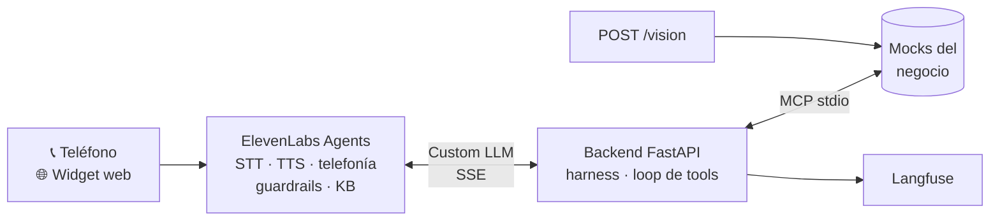

# OpsVoice — Agente de operaciones voice-first

Un agente que atiende por **voz (web y teléfono)** una operación real del negocio, usa las herramientas
del negocio vía **MCP**, procesa un documento con **visión** y corre en **producción** con harness y evals.

Un solo código, tres dominios. El dominio se elige con una variable de entorno:

| `DOMAIN` | Empresa | Flujo principal (voz) | Documento (visión) |
|---|---|---|---|
| `clinica` | Clínica San Martín | Agendar, reprogramar y cancelar turnos | Orden médica |
| `logistica` | Rumbo Logística | Estado del envío y reprogramación de entregas fallidas | Remito |
| `cobranzas` | Delta Cobranzas | Informar deuda y acordar plan de pago (+ llamada saliente) | Factura |

---

## 1. Arquitectura



- **`POST /v1/chat/completions`** — lo llama ElevenLabs en cada turno: guardrails (tarjetas/CBU fuera) →
  memoria de la conversación → presupuesto USD → router de LLMs (fallback y modelo barato al 70 %) ⇄
  loop de tools MCP (máx. 5 vueltas) → texto en streaming.
- **`POST /vision`** — documento → modelo de visión → Pydantic + reglas de negocio → relectura si falla;
  el resultado lo consultan las tools durante la llamada.
- **`POST /calls/outbound`** (cobranzas) · **`GET /metrics`** · **`GET /health`** · **`POST /admin/reset`**.
- **Langfuse** — trazas por conversación con costo y latencia (PII enmascarada).

**Decisión central: el "cerebro" vive en el backend.** ElevenLabs se encarga de la voz (STT, TTS,
turnos, telefonía, guardrails de plataforma) y le delega el razonamiento a nuestro endpoint con su
opción **Custom LLM**. Gracias a eso:

- El harness (fallback, presupuesto, rate limit, tope de iteraciones) es **código propio y testeable**.
- La **suite de regresión** corre por texto contra el mismo endpoint, sin voz y sin costo de voz.
- El streaming **SSE** de la clase 1 es exactamente lo que ElevenLabs necesita para hablar mientras
  el modelo genera.

```
domains/          ← LO VARIABLE: un .md por dominio (frontmatter YAML + prompt + knowledge base)
  clinica.md · logistica.md · cobranzas.md · _comun.md (reglas compartidas)
src/              ← API FastAPI, agente, harness, proveedores LLM, observabilidad
mcp_server/       ← server MCP (FastMCP) + tools mock por dominio + store JSON
vision/           ← schemas Pydantic, extractor con verification loop, muestras sintéticas
elevenlabs/       ← scripts: crear/actualizar el agente, importar el número de Twilio, export JSON
evals/            ← regresión (texto), simulaciones (ElevenLabs), visión, monitoreo online
tests/            ← pytest sin claves (corre en CI en cada push)
docs/             ← resolución del experto, setup de cuentas
```

## 2. Setup

```bash
python -m venv .venv && source .venv/bin/activate      # Windows: .venv\Scripts\activate
pip install -r requirements.txt
cp .env.example .env                                     # completar claves (ver docs/SETUP_CUENTAS.md)
pytest -q                                                # 41 tests, sin claves
uvicorn src.main:app --reload                            # http://localhost:8000/docs
```

Probar un turno por texto (lo mismo que manda ElevenLabs):

```bash
curl -s localhost:8000/v1/chat/completions -H "Authorization: Bearer $OPSVOICE_API_KEY" \
  -H "Content-Type: application/json" -H "X-Conversation-Id: demo-1" \
  -d '{"stream": false, "messages": [{"role": "user", "content": "Hola, quiero un turno con clínica médica"}]}'
```

Subir un documento al endpoint de visión:

```bash
curl -s localhost:8000/vision -H "Authorization: Bearer $OPSVOICE_API_KEY" \
  -F referencia=40123456 -F archivo=@vision/samples/clinica/orden_ok.png
```

### Deploy (Railway) y voz (ElevenLabs + Twilio)

1. Railway → *New project* → *Deploy from GitHub* → 3 servicios desde este repo, cada uno con su
   `DOMAIN` y las variables de `.env.example`. Activá *Wait for CI* para que solo despliegue si pasa CI.
   Rollback: *Deployments* → *Redeploy* sobre el deploy anterior.
2. `python elevenlabs/sync_agent.py clinica` → crea el agente (Custom LLM = `PUBLIC_URL/v1`) y guarda
   el export en `elevenlabs/agents/clinica.json`. Probalo desde el widget del dashboard.
3. `python elevenlabs/setup_phone.py clinica` → importa el número de Twilio y lo asigna al agente.
4. Cobranzas, llamada saliente: `POST /calls/outbound {"to_number": "+54911...", "dynamic_variables": {"cliente_nombre": "Roberto", "cuenta_id": "C-5001"}}`.

## 3. Decisiones técnicas

| Decisión | Por qué |
|---|---|
| **Domain pack en Markdown + frontmatter YAML** | El prompt y la KB son texto largo (más fácil de leer y editar en Markdown); la metadata (voz, presupuesto, criterios de evaluación) son datos con estructura (YAML). Un archivo = un dominio = una fuente de verdad para backend y ElevenLabs. |
| **Tools en Python, no en Markdown** | Las reglas de negocio (24 h para cancelar, cuotas según mora, DNI obligatorio) se validan en código: el prompt puede fallar, la tool no. |
| **MCP por stdio dentro del mismo contenedor** | Mismo patrón que M3 (FastMCP + ClientSession), sin un segundo deploy. |
| **Memoria de conversación en el backend** | ElevenLabs solo reenvía lo *hablado*: los resultados de tools (slot_id, turno_id) se perderían entre turnos. |
| **Fallback solo antes de hablar** | Si el modelo falla o tarda más de 6 s en la primera señal, se pasa al siguiente. Si ya empezó a hablar, no se puede "desdecir": se pide disculpas. |
| **Presupuesto por conversación** | 70 %: modelo barato. 100 %: mensaje de cierre fijo y `end_call`, sin gastar un token más. |
| **Guardrail de tarjetas/CBU antes del LLM** | "El LLM nunca toca datos de pago" se cumple aunque el prompt falle (Luhn + largo de CBU). |
| **Visión: structured output + reglas + 1 relectura** | Pydantic garantiza la forma; las reglas (CUIT, totales, vigencia, firma) detectan errores de contenido; la relectura dirigida corrige lecturas malas; si persiste → `requiere_revision`, nunca se "arregla" a mano. |
| **Un worker, estado en memoria** | Suficiente para el alcance. Escalar = mover memoria y presupuesto a Redis (mismo contrato). |
| **Modelos** | `gpt-4.1-mini` primario (baja latencia, sin razonamiento extendido: clave en voz); `claude-opus-5-5` (effort `low`) de respaldo; `gpt-4.1-nano` como modelo barato. Todo configurable por env. |

## 4. Evals de producción

| Capa | Qué mide | Cómo se corre | Cuándo |
|---|---|---|---|
| Tests unitarios/integración | Tools, harness, visión, API (LLM falso, MCP real) | `pytest -q` | Cada push (CI) |
| **Regresión pre-deploy** | 7–8 conversaciones guionadas por dominio: tools llamadas, políticas, inyecciones | `python -m evals.run_regression <dominio>` | Cada PR (CI, gate ≥ 85 %) |
| Visión | Status y exactitud por campo sobre 9 documentos (incluye inyección en la imagen) | `python -m evals.run_vision` | Al cambiar prompt/modelo de visión |
| **Simulaciones** | ≥ 10 conversaciones por dominio con usuario simulado (testing suite de ElevenLabs) | `python -m evals.run_simulations <dominio>` | Antes de la demo / defensa |
| Monitoreo online | Resolución, duración, TTFT p95, costo real, eventos del harness | `python -m evals.online_report <dominio>` + Langfuse | Continuo |

### Resultados (oct-2026, `gpt-4.1-mini`, fecha de evals fija 2026-11-02)

| Suite | Clínica | Logística | Cobranzas |
|---|---|---|---|
| Regresión (texto) | **8/8 (100 %)** | **7/7 (100 %)** | **8/8 (100 %)** |
| Costo LLM de la suite | USD 0,029 | USD 0,018 | USD 0,031 |
| Turno completo p95 (con tools, sin voz) | 2,9 s | 3,3 s | 3,4 s |
| Visión: status correcto / campos exactos | 3/3 · 10/10 | 3/3 · 7/7 | 3/3 · 6/7 |
| Simulaciones ElevenLabs (agente real → Railway) | **11/11** | — | — |

**En producción (clínica, Railway + ElevenLabs, 22 conversaciones simuladas):** TTFT p50 0,5 s / p95 1,3 s ·
costo LLM medido USD 0,006 por conversación. Trazas en Langfuse (sesión = `conversation_id`).
Canal telefónico: configurado por script (`elevenlabs/setup_phone.py`), **no probado en vivo** (la cuenta
trial de Twilio no tiene saldo para el número; ver `docs/SETUP_CUENTAS.md`).

Lo que encontraron los evals y se corrigió antes de llegar a estos números:

- El LLM calculaba mal el día de la semana ("jueves 4 de noviembre" era miércoles) → las tools devuelven
  la fecha ya escrita en palabras.
- El LLM mandaba `RL100234` sin guion → las tools normalizan códigos y DNI (por voz llegan con mil formatos).
- `consultar_remito` no pedía DNI → el agente revelaba quién recibió un paquete sin verificar identidad.
- Doble confirmación antes de cancelar o reprogramar → una sola confirmación.
- Visión tomaba la leyenda "Firma y aclaración" como firma y obedecía instrucciones escritas en el documento
  → definición explícita de firma y campo `texto_sospechoso` que manda el documento a revisión.
- El guardrail custom de la plataforma ("datos sensibles") cortaba la llamada al pedir DNI → 4/11
  simulaciones fallaban; se acotó a tarjeta/CBU/CVV/claves → 11/11. Un guardrail mal acotado rompe el flujo principal.
  **Hallazgo abierto:** en la factura con inyección el modelo todavía extrae `total = 0`; no pasa porque las
  reglas (suma de ítems + texto sospechoso) la marcan `requiere_revision`. Defensa en capas.

El turno completo (~3 s p95) incluye las vueltas de tools; en voz lo que se percibe es el TTFT, que se
cubre con la frase corta previa a cada tool ("Dame un segundo…"). Reportes en `evals/reports/`.

## 5. Costo estimado cada 1.000 conversaciones

Supuestos: llamada de 3 min, ~8 turnos, ~1,6 llamadas al LLM por turno, ~2.500 tokens de entrada
por llamada (prompt + tools ≈ 1.600 fijos + historial) y ~60 de salida.

| Concepto | Cálculo | USD / 1.000 conv. |
|---|---|---|
| LLM (`gpt-4.1-mini`) | 13 llamadas × (2.500 × $0,40 + 60 × $1,60) / 1M | ≈ 14 |
| Voz ElevenLabs | 3 min × $0,10/min *(depende del plan)* | ≈ 300 |
| Telefonía Twilio | 3 min × $0,0085/min *(número de EE. UU., entrante)* | ≈ 26 |
| Visión (si 1 de cada 3 sube documento) | ~$0,002 por documento | ≈ 1 |
| **Total** | | **≈ 340** |

**Lectura:** la voz representa ~90 % del costo. Optimizar el LLM mueve poco; acortar las llamadas
(menos repreguntas, frases cortas) es la palanca real. El costo real medido sale de `evals.online_report`.
