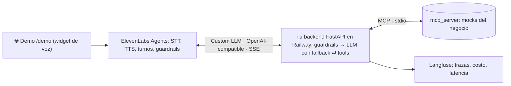

# OpsVoice: Scaffold oficial · Proyecto Integrador M4

Agente de operaciones **voice-first**: atiende por voz, desde una demo web pública, una operación del negocio,
usa las herramientas del negocio vía **MCP**, procesa un documento con **visión** y corre en
**producción** con harness y evals.

Este scaffold trae resuelto el *plumbing* (estructura, Docker, CI, deploy, mocks del negocio, datos)
para que las horas del módulo vayan a lo que el módulo enseña. Buscá los `TODO [Cxx]` en el código.

## 1. Elegí tu dominio

| `DOMAIN` | Empresa | Flujo principal (voz) | Documento (visión) |
|---|---|---|---|
| `clinica` | Clínica San Martín | Agendar, reprogramar y cancelar turnos | Orden médica |
| `logistica` | Rumbo Logística | Estado del envío y reprogramación de entregas fallidas | Remito |
| `cobranzas` | Delta Cobranzas | Informar deuda y acordar plan de pago (el cliente llama o campaña del agente) | Factura |

Todo lo específico del dominio está en `domains/<dominio>.md`: persona, flujo, políticas y knowledge base
(Markdown) + metadata (frontmatter YAML: voz, presupuesto, criterios de evaluación, datos de prueba).
Leelo primero.

## 2. Qué viene hecho y qué construís vos

| Ya viene | Construís vos | Clase |
|---|---|---|
| `domains/` (prompt, políticas, KB) · `src/domain.py` | - (podés ajustar el prompt) | - |
| `mcp_server/` con las tools mock y sus datos · `src/mcp_client.py` | Conectarlas al loop del agente | C16 |
| `src/main.py` con arranque, `/health`, `/admin/reset` y la demo pública `/demo` | `/v1/chat/completions` con SSE + auth Bearer | C16 |
| `Dockerfile`, `docker-compose.yml`, `railway.json`, CI | Deploy en Railway con URL pública (**semana 1**) | C17 |
| `src/llm/providers.py` (OpenAI listo) · `src/llm/pricing.py` · `tests/fakes.py` (LLM falso) | `src/harness/*`, `src/agent.py` (opcional: respaldo con Anthropic) | C18 |
| `vision/schemas.py` (campos) · `vision/samples/` · golden set | Reglas de negocio + `vision/extractor.py` + `/vision` | C19 |
| `elevenlabs/export_agent.py` · `src/demo.py` (widget de voz) | Agente en ElevenLabs (Custom LLM → tu backend), probado en `/demo` | C20 |
| Runners de `evals/` + 2 casos de ejemplo por suite | Casos de regresión, ≥ 10 simulaciones, reportes, costos | C21 |

## 3. Setup

```bash
python -m venv .venv && source .venv/bin/activate      # Windows: .venv\Scripts\activate
pip install -r requirements.txt
cp .env.example .env                                     # ver docs/SETUP_CUENTAS.md
pytest -q                                                # tests de los mocks: tienen que pasar desde el día 1
uvicorn src.main:app --reload                            # http://localhost:8000/docs
```

Con Docker (levanta el dominio de `DOMAIN` del `.env` en http://localhost:8000): `docker compose up --build`.

Para ver qué te falta: `git grep -n "TODO \[C"` (cada TODO dice en qué clase se ve).
Para testear tu agente y tu harness sin claves ni tokens, usá el LLM falso de `tests/fakes.py` (el docstring
trae un test de ejemplo): esos tests corren en el CI en cada push.

### Probalo por texto (antes de sumar la voz)

Cuando termines `/v1/chat/completions` (C16), probalo sin ElevenLabs. Con `stream: false` devuelve la
respuesta entera y las tools que llamó (es lo mismo que usa la suite de regresión):

```bash
curl -s localhost:8000/v1/chat/completions \
  -H "Authorization: Bearer $OPSVOICE_API_KEY" -H "Content-Type: application/json" -H "X-Conversation-Id: prueba-1" \
  -d '{"stream": false, "messages": [{"role": "user", "content": "Hola, quiero sacar un turno con clínica médica"}]}'
```

Para seguir la conversación, repetí el pedido con el mismo `X-Conversation-Id` y el mensaje nuevo.
Sacá `"stream": false` para ver el streaming SSE tal como lo recibe ElevenLabs (`curl -N`).

## 4. Arquitectura propuesta



El razonamiento vive en **tu backend**: por eso el harness, las trazas y la suite de regresión son
código tuyo y no configuración de la plataforma.

## 5. Recomendaciones

- **Deploy en la semana 1** y se itera sobre producción.
- Validá el flujo completo **por texto** (`stream: false`) antes de sumar la voz en C20.
- En voz medí **latencia p95**, no promedio.
- El LLM **nunca** toca datos de pago: en cobranzas se envía un link.
- Grabá una demo corta de cada avance.

## 6. Entregables (README final)

Setup · dominio y arquitectura · decisiones técnicas · resultados de evals de producción
(`evals/reports/`) · costo medido cada 1.000 conversaciones · URL pública con la demo de voz (`/demo`) ·
export del agente (`elevenlabs/agents/<dominio>.json`) · video demo ≤ 3 min de una conversación en `/demo`.
