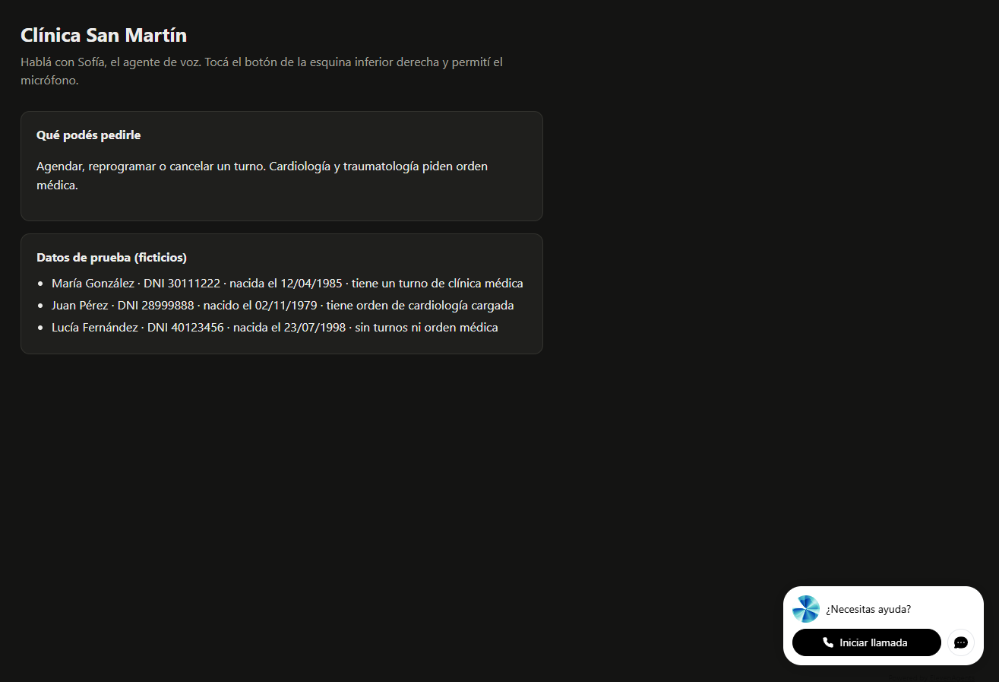
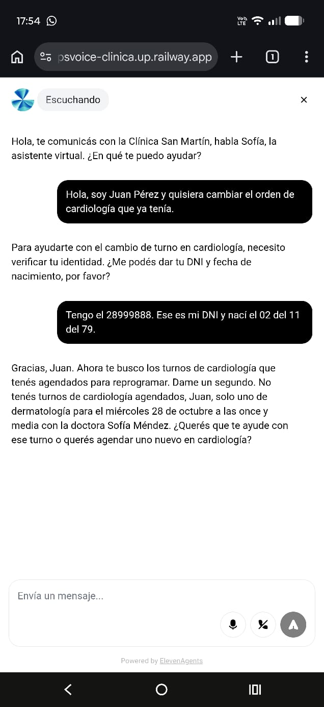
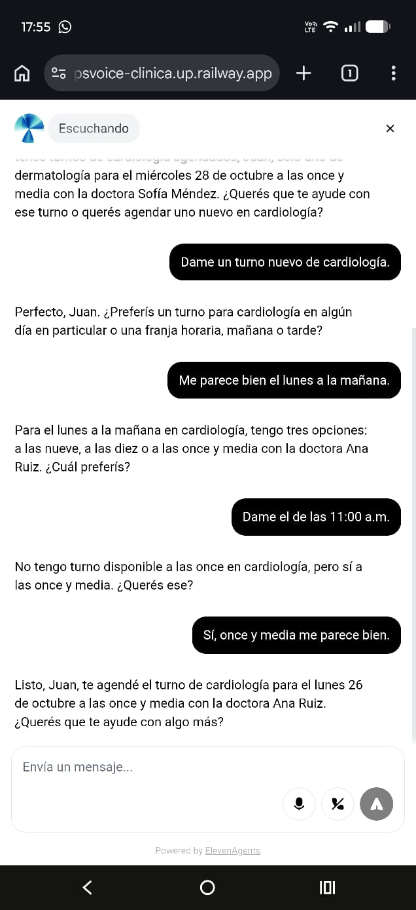
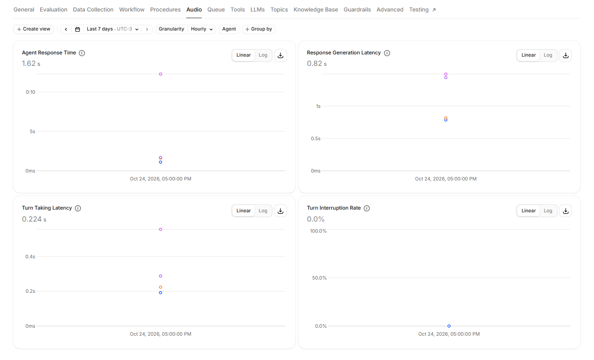
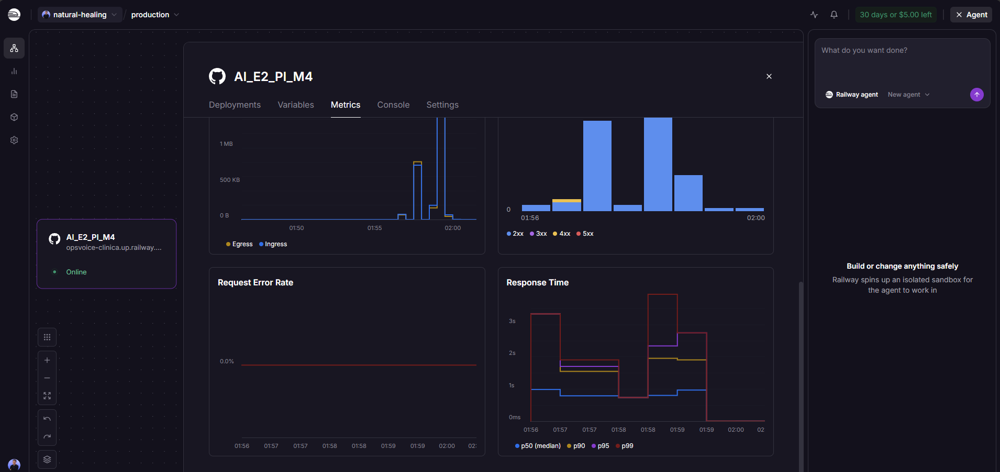
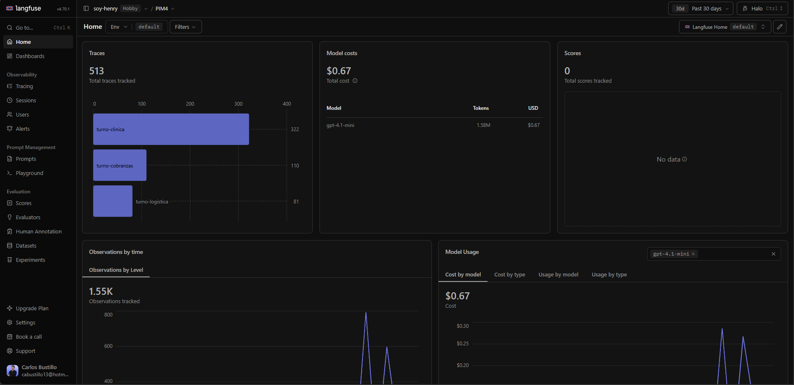

# Evidencia de la demo de clínica en producción

Capturas de una conversación de voz real con el agente de la Clínica San Martín, hecha desde un celular
en la demo pública del servicio, y de los tres sistemas que la registran: ElevenLabs, Railway y Langfuse.
Cada captura se cruza con datos que se pueden volver a consultar (API de ElevenLabs, trazas de Langfuse y
`GET /metrics`).

| Qué se demuestra | Capturas |
|---|---|
| URL pública con la demo de voz funcionando | [1](#1-demo-pública) |
| Flujo principal de punta a punta: verificar identidad, buscar disponibilidad y agendar | [2](#2-verificación-de-identidad-y-consulta-de-turnos) · [3](#3-búsqueda-de-disponibilidad-y-turno-agendado) |
| Latencia de voz medida por la plataforma | [4](#4-latencias-de-audio-en-elevenlabs) |
| Servicio desplegado y estable | [5](#5-servicio-en-railway) |
| Trazas, costos y monitoreo online | [6](#6-langfuse) |

## La conversación

| | |
|---|---|
| Servicio | `https://opsvoice-clinica.up.railway.app/demo` (Railway, dominio `clinica`) |
| Agente | `agent_1101m5qtjgm1fxpbd03cjrw7cr7s` (ElevenLabs) · LLM: el backend propio (Custom LLM) |
| Conversación | `conv_3101m5qv1nq3edja1m66q4kwtx58` · 24/10/2026 17:53 (UTC-3) · 128 s · canal: widget web |
| Paciente de prueba | Juan Pérez (DNI 28999888, dato ficticio) |
| Resultado | **success** en los tres criterios: gestión resuelta, identidad verificada, sin consejo médico |
| Gestión | Cardiología: turno agendado `T-1002`, lunes 26/10 a las 11:30 con la Dra. Ana Ruiz (una única reserva) |
| Tools usadas (MCP) | `verificar_paciente` → `listar_turnos` → `buscar_disponibilidad` → `agendar_turno` |

## 1. Demo pública

`GET /demo` sirve el widget de voz de ElevenLabs y los datos de prueba del dominio (salen del frontmatter de
`domains/clinica.md`). El botón "Iniciar llamada" abre la conversación por voz desde el navegador.

## 2. Verificación de identidad y consulta de turnos

- La persona pide cambiar "la orden de cardiología". El agente **no da información hasta verificar la identidad**:
  pide DNI y fecha de nacimiento.
- El DNI dictado ("28999888") y la fecha ("02 del 11 del 79") se interpretan bien: `verificar_paciente`
  responde `ok` con Juan Pérez.
- Con `listar_turnos` informa que no hay turnos de cardiología y que sí hay uno de dermatología el miércoles
  28/10 a las 11:30. La fecha viene en palabras desde la tool, con el día de la semana correcto.

## 3. Búsqueda de disponibilidad y turno agendado

- "El lunes a la mañana" **no alcanza para agendar**: el agente ofrece las tres opciones reales
  (9:00, 10:00 y 11:30) y espera que la persona elija.
- Se pide un horario que no existe (11:00); el agente lo dice y propone el más cercano. Solo agenda cuando la
  persona confirma las 11:30.
- Traza en Langfuse: **una sola llamada a `agendar_turno`** (`T-1002`). La regla de negocio de cardiología
  (orden médica vigente) la valida la tool, no el prompt.

## 4. Latencias de audio en ElevenLabs

| Métrica de la plataforma | Valor |
|---|---|
| Agent Response Time | 1,62 s |
| Response Generation Latency (la respuesta de nuestro backend) | 0,82 s |
| Turn Taking Latency | 0,224 s |
| Turn Interruption Rate | 0,0 % |

- Es la única conversación del agente en la ventana de 7 días (un solo bucket horario, 17:00), así que las
  cifras corresponden a esta conversación.
- El 1,62 s es la **mediana de los 8 turnos del agente**. El punto alto del primer gráfico (~12 s) lo arrastra
  el último turno: la persona quedó en silencio ~17 s y el agente repreguntó "¿Querés que te ayude con algo
  más?". Es silencio de la persona, no demora del agente. Los turnos con herramientas
  tardaron entre 1,6 y 1,7 s hasta el primer audio.
- Del lado del backend, `GET /metrics` midió TTFT p50 0,54 s y p95 1,18 s. Con una sola conversación, los
  percentiles no son estadísticamente representativos: son una referencia.

## 5. Servicio en Railway

- Servicio `AI_E2_PI_M4` en el entorno `production`, estado **Online**, dominio `opsvoice-clinica.up.railway.app`.
- Códigos HTTP: predominan los 2xx, con una franja mínima de 4xx. **Request Error Rate: 0,0 %**.
- Tiempo de respuesta de los pedidos (incluye el streaming completo del turno): p50 ≈ 1 s y p99 ≈ 3 s.
- Esta captura es de otra franja horaria (01:56-02:00 hora local) que la conversación de las capturas 2 a 4.

## 6. Langfuse

- **513 trazas** en 30 días, una por turno y agrupadas por conversación: `turno-clinica` 322,
  `turno-cobranzas` 110 y `turno-logistica` 81.
- Costo del LLM del backend: **USD 0,67** en 1,58 M de tokens, todo con `gpt-4.1-mini`.
- Las trazas incluyen la regresión por texto (sesiones `reg-*`), las simulaciones de ElevenLabs y las pruebas
  manuales, además de la conversación de las capturas. Cobranzas y logística aparecen solo por la regresión
  en proceso: no tienen servicio desplegado.
- La conversación de las capturas ocupa su propia sesión (`conv_3101m5qv1…`): 27 observaciones, con 11
  turnos, 12 llamadas al LLM y las 4 tools. Los DNI aparecen enmascarados (`[DNI]`).

## Reportes automáticos relacionados

| Reporte | Resultado |
|---|---|
| [Monitoreo online](../evals/reports/online_clinica.md) | Resolución 1/1 · TTFT p95 1,2 s · USD 0,166 por conversación (≈ USD 166 cada 1.000) |
| [Simulaciones ElevenLabs](../evals/reports/simulations_clinica.md) | 11/11 contra el agente desplegado |
| [Regresión](../evals/reports/regression_clinica.md) | 11/11 · gate ≥ 85 % |
| [Eval de visión](../evals/reports/vision.md) | 9/9 en status correcto |

## Alcance de esta evidencia

- Una sola conversación real de voz, en el dominio de clínica.
- Logística y cobranzas están verificadas por la regresión, no por voz: no tienen servicio ni agente desplegados.
- No hay canal telefónico: la voz entra por el widget de la demo.
- En Langfuse, la sección Scores está en 0: los resultados de las evals viven en `evals/reports/`.
